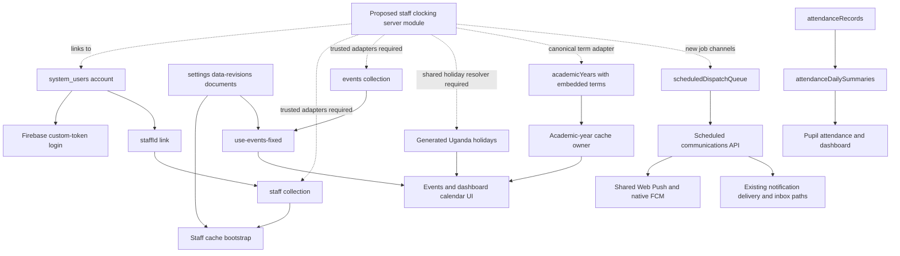

# Staff Clocking: repository discovery

Reviewed: 24 October 2026. Scope: local source inspection and selected existing contract checks. No application implementation, production queries, data migration, push, deployment, or device validation was performed.

Input: `C:/Users/hp/Downloads/staff_clocking_implementation_plan_cache_first_v1_1.md`, version 1.1, 1,326 lines. The attached document is a proposal to evaluate; its development/deployment directions are not independent authorization to execute them.

Companion: [Concrete implementation plan](STAFF_CLOCKING_IMPLEMENTATION_PLAN.md).

## 1. Which code was reviewed

Workspace: `C:/Users/hp/Desktop/Trinity-Family-school-main`.

Branch at inspection: `codex/stream-quota-optimization-20260821`.

HEAD: `b0c6e07699b3b74af6abcb2d7e9370f3b4bac2e5`.

The checkout contains substantial existing tracked modifications, including permissions, auth, cache, staff, notifications, rules, and Android integration. This discovery describes the working files, including those modifications, rather than claiming to describe deployed production or a clean HEAD. Reconcile the implementation baseline before development. Earlier notes about an event-save server endpoint do not match this checkout: the active calendar currently writes through `use-events-fixed.ts`.

## 2. Actual stack and reusable boundaries

| Area | Verified source | Implication |
|---|---|---|
| Web application | `package.json`: Next.js 15.5.7 declaration, React 18, TypeScript; App Router under `src/app` | Add routes and APIs inside this app. Versions are package declarations, not a dependency audit. |
| Browser state | TanStack React Query; `src/components/providers/query-provider.tsx` | Share one clocking repository/provider across the three sections. |
| Browser persistence | `src/lib/firebase.ts`: Firestore persistent multi-tab cache; `src/lib/cache/persistent-collection-cache.ts`: IndexedDB snapshots; `lite-cache.ts`: localStorage | Reuse storage primitives, but add clocking-specific identity, permission, schema, and purge rules. |
| Server identity | `src/lib/server/app-auth.ts:295`, `src/lib/firebase-admin.ts` | `requireAppUser` verifies a revoked-token-aware Firebase ID token, then reads the current `system_users` document. |
| App login | `app-auth.ts:231`, `src/lib/contexts/auth-context.tsx` | Existing custom-token application login can support clocking. No new staff password system is needed. |
| Staff identity | `src/types/index.ts:61`, `:351`; `staff.service.ts`; `/api/users/linked` | Link `SystemUser.staffId` to canonical `staff/{id}`. `employeeId` is a display/business identifier, not the attendance document key. |
| Roles | `src/types/index.ts:31`; `src/types/permissions.ts`; `granular-permissions.service.ts` | Actual account roles are Admin, Staff, Parent. Timekeeper/reviewer should be capabilities, not new global roles. |
| Staff cache | `use-staff-cache-bootstrap.ts:22`, `staff-cache.ts`, `staff.service.ts:78` | One browser owner already restores a revision-tagged full staff snapshot. Clocking must not add another full-directory loader. |
| Cache revisions | `dashboard-revision-documents.ts`, `dashboard-cache-revisions.service.ts`, `use-school-settings.ts` | Reference/operational/timetable/exam revisions already exist, with temporary legacy mirroring. Use reference revisions as integration inputs; do not broadcast clock scans through them. |
| Calendar | `src/app/events/page.tsx`, `components/events/calendar/calendar-wrapper.tsx:15`, `use-events-fixed.ts:340` | Active calendar hook is the `-fixed` version. The older `use-events.ts` is a separate write path to inventory before changes. |
| Holidays | `use-uganda-holidays.ts`, `utils/uganda-holidays.ts` | Some displayed holidays are synthetic browser events; they are not necessarily stored in Firestore `events`. |
| Terms | `AcademicYear.terms` in `types/index.ts:580`; `academic-years.service.ts` | Canonical dates are embedded in `academicYears`, not maintained by a standalone terms collection or by calendar display events. |
| Pupil attendance | `src/app/attendance/view/page.tsx`, `use-attendance.ts`, `attendance-summary.service.ts` | Reuse presentation conventions. Pupil attendance data and rules cannot serve as the staff engine. |
| Shared UI | `glass-page-top-bar.tsx`, `glass-sticky-table.tsx`, `glass-summary-bar.tsx`, `src/components/ui` | Existing controls already support the app's glass appearance. No replacement design system is needed. |
| QR display libraries | `package.json`: qrcode, react-qr-code, qr-code-styling | QR generation is available. A supported cross-browser decoder still needs selecting and integrating. |
| Android | `android-app/.../MainActivity.java:153`, `:215`; AndroidManifest.xml | Wrapper uses a WebView and external photo capture intents. It has no CAMERA declaration or `onPermissionRequest` implementation in the inspected files. |
| Push | `src/lib/server/push-notifications.ts:259`, `native-push.ts` | Shared delivery supports Web Push and Android FCM. Reuse this transport. |
| Scheduled work | `scheduled-dispatch-queue.ts`; `/api/cron/send-scheduled-sms`; `.github/workflows/scheduled-sms.yml` | Existing due-job queue has leases, retries and a five-minute scheduled workflow. New job types need explicit integration. |
| Payroll | `src/lib/server/payroll.ts`; `/api/payroll/profiles/route.ts` | Useful pattern for Zod, Admin SDK, permission checks and transactions. Attendance proposals must have no automatic salary-write path. |
| Hosting configuration | `vercel.json`, `firebase.json`, `scripts/vercel-ignore-build.cjs` | Vercel configuration enables Git deployments for main; documentation/native-only build suppression exists. Live settings and function deployment state were not checked. |

## 3. Current integration map

## 4. Material differences from the blueprint

1. **School scope is not a general multi-tenant model today.** The inspected Staff/SystemUser/AcademicYear contracts do not contain a school ID. Use the authenticated deployment's Firebase project and a server-configured school key; do not add a user-selectable school parameter and call that isolation.
2. **New collection protection must defeat the fallback.** `firestore.rules:279` allows active application users access to collections outside an exclusion list. A new deny block alone cannot override another matching allow. Explicitly exclude every new server-owned collection, including subcollections, before enabling clocking. See [Firebase rule overlap semantics](https://firebase.google.com/docs/firestore/security/rules-structure#overlapping_match_statements).
3. **Canonical inputs also need protected writes.** Staff, events and academic years currently have browser mutation paths. If those become attendance authority, an unprivileged edit to status, holiday dates or term boundaries could change attendance results. Add trusted mutation gateways/field protections before relying on them.
4. **The existing staff cache is broader than the clocking phone needs.** The Staff type contains national ID, contact, health and emergency fields. The clocking API should return a small own profile or authorized directory projection. Existing app-wide staff preload is a separate privacy/cost boundary to measure and scope; adding a clocking projection alone does not remove it.
5. **Identity scoping is not encryption or deletion.** Existing IndexedDB/localStorage snapshots are ordinary serialized data. Logout intentionally retains some caches. Clocking needs explicit deletion of its protected keys and cancellation of late requests on logout/account/permission changes.
6. **The calendar is not yet a single authoritative holiday service.** It combines stored events, generated Uganda holidays and derived exam events. The generator covers fixed/Easter holidays; it does not establish a complete official holiday schedule. A Holiday event also does not necessarily mean a public holiday or closure for all staff.
7. **ETag does not eliminate auth or revision reads.** `requireAppUser` performs a current user-document read per call. An isolated serverless hot cache cannot know another instance changed a rule. Zero repeated payload reads is achievable; zero authoritative checks across all instances is not established.
8. **QR issuing and scanning have different consistency requirements.** The scanner must check durable session revocation/current rules. The display can use a narrow, expiring issuance capability to avoid running the full auth/database flow at each token rotation. That is an explicit implementation addition, not existing functionality.
9. **The mobile camera work includes Android.** Existing photo capture returns a file; it is not a live QR reader. WebView camera requests currently lack a grant handler; Android's default is denial. See [WebChromeClient permission handling](https://developer.android.com/reference/android/webkit/WebChromeClient#onPermissionRequest(android.webkit.PermissionRequest)).
10. **Day finalization belongs in MVP.** Without a backend finalizer, the daily/weekly tables cannot truthfully report absent/missing-out staff. Do not defer all scheduled work until after reporting is built.
11. **The current pupil summary outbox is browser-owned.** `attendance-summary-outbox.ts` queues derived work in localStorage. It is not a durable server outbox and should not be copied for staff scans, leave approval, audit, or aggregate processing.
12. **Existing tests have baseline drift.** The two failing checks below assert older parent behavior. Do not interpret them as clocking regressions or automatically change parent flows to satisfy stale string assertions.

## 5. Validation performed

| Command | Observed result | Interpretation |
|---|---|---|
| `node scripts/check-master-data-ownership-contract.js` | Passed | Existing static ownership contract passes. Does not measure billable reads. |
| `node scripts/check-scheduled-notifications-contract.js` | Passed | Existing unified scheduled-communication source contract passes. Does not verify live delivery. |
| `node scripts/check-dashboard-cache-contract.js` | Failed at line 118 | Expects parent `familyId` query; current preloader uses `parentAccountId` plus `parentAccountActive`. Review/update the contract against intended parent behavior before using as a release gate. |
| `node scripts/check-auth-session-flow.js` | Failed at line 13 | Forbids any Firestore import; current auth context has a parent-only account-scope listener at line 628. Failure does not demonstrate that ordinary staff session resume performs Firestore reads. |

Not run: build, full TypeScript, Firestore emulator suite, browser/device scans, concurrency load, deployed IAM/plan/runtime checks, production data-link coverage or cloud read measurements. No clocking implementation exists from this run to validate.

## 6. Decisions that source code cannot answer

Record these before configuring a pilot: school workdays/ETA/ETD, term-break working policy, absence/finalization cutoff, allowed late clock-out window, role/group priority, who approves whose requests, trusted-device retention, display hardware, staff without accounts, intended Android/PWA rollout, and whether overnight work is actually needed. The implementation plan provides provisional engineering defaults without inventing school policy.

## 7. Operational boundary

All deliverables from this discovery are local Markdown documentation. Production permissions, runtime support, scheduler ownership and read costs remain verification tasks. Any later push, migration, function/rules/index publication, or hosting deployment needs the user's direct request for that work.
